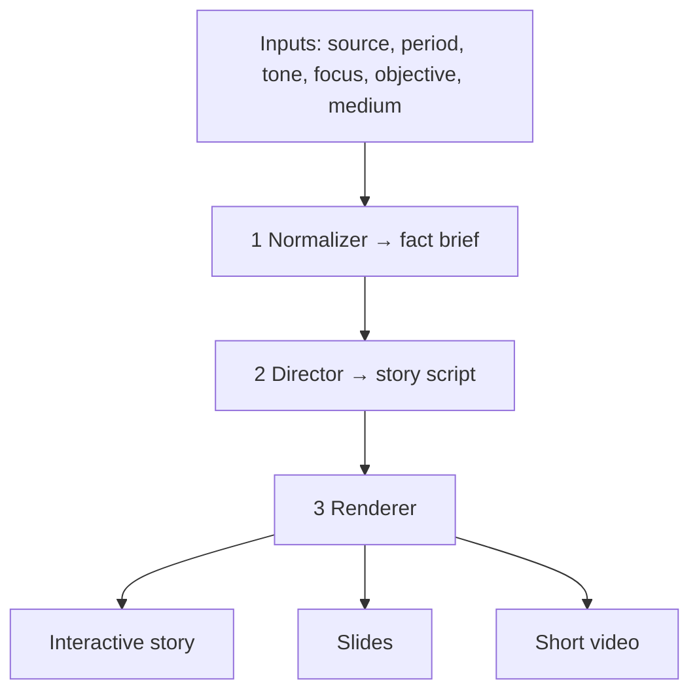

# Perspective

One fact spine, told for the person in front of it. The same material can serve a hospital morning round, a family explanation, or a board update. Period, tone, focus, and objective change the order of the story. They do not change the facts.

## Decision

Use three agents.

1. **Normalizer.** Any input becomes one fact brief for the chosen period. It names gaps. It does not pick a story.
2. **Director.** Focus, objective, and tone order that brief into a story script. A beat that is not in the brief is dropped, or it is marked not documented. Language may get simpler. No new result, dose, or diagnosis is added.
3. **Renderer.** The same script becomes the surface the person watches: an interactive story, slides, or a short video.

This matches the board. The left side is the brief (prompt, period, tone, simple or fuller). The middle is ordering. The right side is focus, objective, and the way it is presented. The bottom loop is the quality filter.

Current tools split the same way, then stop at slides. NotebookLM (now Gemini Notebook) keeps claims tied to the sources you gave it. Gamma turns an outline into an editable deck. DeepSlide plans a timed story before it draws slides. A six-agent slide factory is for layout. It is the wrong size for a service whose output can be a story, a deck, or a video.

## Morning round

Period: since the last round. Tone: short and factual. Focus: what changed overnight, what is unstable, and the decision to make before leaving the room. Objective: a plan for today. Medium: a one-beat-at-a-time story of about a minute, with each beat opening back to the source fact.

The same chart for the nurse that morning leads with why the patient is here, the latest vitals, allergies, and active high-risk medicines. Both tellings cite the same facts.

## Demo

Build the interactive story first. One beat, then the next. Slides and a short video are later renderers of that script. They do not get a second pass over the raw chart, so a video cannot invent a scene the story did not already contain.

